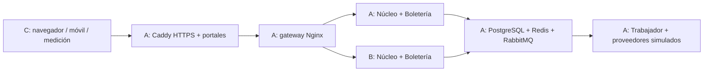

# Plan de demostración con dos servidores y un cliente

Estado: **preparación documental**, sobre `feature/sebastian`, referencia revisada
`ef384d9` (15/11/2026). No se instala ZeroTier ni se crean redes; no se modifican
firewalls, Compose, gateway o claves, ni se arrancan réplicas o provocan caídas.
Los pasos inferiores son para una entrega posterior. No constituyen resultados
de disponibilidad ni completan RNF-03/04/05/06/10.

El requisito vigente reemplaza la nota anterior de «un servidor con varios
clientes»: **dos computadores con aplicaciones, A y B, y un cliente C**. Durante
la demostración se detendrá manualmente B y se medirá lo que observa C.

## Montaje mínimo propuesto

| Equipo | Componentes | Condición durante la caída |
|---|---|---|
| A, servidor que permanece encendido | Una instancia de Núcleo y Boletería; gateway Nginx; portales; entrada HTTPS con el Caddy existente; PostgreSQL, Redis y RabbitMQ compartidos; un Trabajador; correo y pasarela simulados | Debe permanecer encendido, conectado y con capacidad suficiente para asumir todo el tráfico |
| B, servidor que se podrá tumbar | Una instancia de Núcleo y otra de Boletería, conectadas a los mismos datos y broker de A | Se detiene uno de sus procesos/contenedores o se apaga **todo B**, en escenarios separados |
| C, cliente | Navegador y `curl` para medir; aplicación móvil opcional | Accede siempre al mismo nombre/URL de A; no cambia manualmente la URL a otra réplica |



La red de ZeroTier se usará como transporte entre equipos, cuando se autorice
su configuración. No replica bases ni convierte los DNS/redes bridge de Docker
en una red Docker compartida. No se propone Swarm, Kubernetes, otro balanceador
ni otra plataforma. Mantener un solo Trabajador reduce el alcance de la prueba;
los consumidores y temporizadores que ya incorpora cada Núcleo/Boletería seguirán
existiendo en las dos instancias y requieren las cautelas indicadas más abajo.

### Qué caída demuestra y qué no

| Fallo | Efecto esperado a validar | Límite |
|---|---|---|
| Proceso Node de Núcleo o Boletería en B terminado abruptamente | Nuevas lecturas pasan a la instancia de A; Docker puede reiniciar el proceso según `restart: unless-stopped` | Puede fallar la solicitud en curso. Un contenedor vivo pero `unhealthy` no se reinicia solo por esa condición |
| Contenedor de B detenido manualmente | A atiende hasta que el operador vuelva a arrancarlo | `docker stop` no equivale a un fallo de proceso con reinicio automático |
| Computador B apagado o su red desconectada | A conserva gateway, datos, sesión y una instancia de cada aplicación | Se pierde toda conexión HTTP/SSE que estuviera ligada a B; la detección depende de errores/timeouts, no solo de DNS |
| Computador A apagado | C pierde entrada web/API y B pierde PostgreSQL, Redis, RabbitMQ y proveedores | **No hay continuidad de servicio demostrable para esta caída** |
| Gateway/Caddy, PostgreSQL, Redis, RabbitMQ o Trabajador de A caído | Afecta entrada, operaciones o trabajo asíncrono según la pieza | Siguen siendo puntos únicos de fallo, sin réplica ni conmutación en este montaje |

El caso principal será apagar **B**, conservando A y C. No se presentará como
tolerancia a la caída de cualquiera de los dos servidores. Tampoco acredita la
recuperación de una escritura cuyo resultado quedó incierto.

## Qué existe y qué necesita adaptación

| Fuente revisada | Reutilización y diferencia respecto de esta propuesta |
|---|---|
| [DEMOSTRACION-ATRIBUTOS.md](../../App/infra/DEMOSTRACION-ATRIBUTOS.md), sección 3 | Evidencia histórica local de reparto y caída de proceso; sus cifras no se trasladan a dos computadores |
| [demo-disponibilidad.sh](../../App/infra/demo-disponibilidad.sh) | Ya consulta `X-Servidor`, cuenta HTTP y observa recuperación. **No ejecutarlo en este montaje sin adaptarlo**: escala y mata un proceso automáticamente en un solo Docker; usa el Compose base/escalado y elige su víctima por el primer contenedor |
| [docker-compose.yml](../../App/infra/docker-compose.yml) | Programas sin `container_name` fijo para Núcleo/Boletería; puertos 3002/3001, proveedores, salud, claves y preparación SQL separada |
| [docker-compose.escalado.yml](../../App/infra/docker-compose.escalado.yml) | Elimina los puertos publicados para varias réplicas **en el mismo host**. No aplicarlo a B sin otra publicación: A necesita alcanzar B:3002/3001 |
| [docker-compose.remoto.yml](../../App/infra/docker-compose.remoto.yml), [iniciar.sh](../../App/infra/iniciar.sh) | Ya permiten datos remotos con `HOST_*`/`PUERTO_*`, y `--datos` usa Redis del host en 6380. No balancean aplicaciones entre hosts. `--rol servicios` también inicia gateway, portales y Trabajador; no es la selección deseada para B |
| [nginx.conf](../../App/gateway/nginx.conf), [nginx-principal.conf](../../App/gateway/nginx-principal.conf) | Dos upstreams, `X-Servidor: $upstream_addr` y log `upstream=… rt=…`. DNS Docker `127.0.0.11`, caché 5 s, resolución 3 s; destinos actuales `nucleo:3002` y `boleteria:3001`, solo del Docker local |
| [docker-compose.produccion.yml](../../App/infra/docker-compose.produccion.yml), [Caddyfile](../../App/infra/produccion/Caddyfile) | Caddy y API del mismo origen ya existen. El override de producción cierra **todos** los puertos backend/datos: no puede aplicarse intacto si B debe llegar a los proveedores de A y A a B |

El gateway de A deberá conservar el destino local y añadir **explícitamente**
el destino publicado de B en cada upstream. Esquema ilustrativo, con marcadores
que deben sustituirse; **no es configuración ejecutable**:

```nginx
upstream nucleo_http {
    zone nucleo_http 64k;
    server nucleo:3002 resolve;  # Docker local de A
    server <IP_ZT_B>:3002;       # publicación de B alcanzable desde el contenedor gateway
}
upstream boleteria_http {
    zone boleteria_http 64k;
    server boleteria:3001 resolve;
    server <IP_ZT_B>:3001;
}
```

Esto no es descubrimiento automático de computadores. Si cambian la dirección
o el puerto de B habrá que actualizar y validar el render. Si se usan nombres,
deberán resolver **desde el contenedor gateway**, no solo desde el anfitrión;
añadirlos al archivo hosts del cliente no basta. La pertenencia al upstream y la
sonda Docker `healthy` son mecanismos distintos: no hay comprobación activa de
salud de B en este gateway. Los fallos se detectan al intentar solicitudes.

Actualmente no hay directivas explícitas `proxy_next_upstream`,
`proxy_next_upstream_tries`, `max_fails` o `fail_timeout` en estos archivos: se
heredan los valores de Nginx. Se conservan `proxy_connect_timeout 5s`,
`proxy_read_timeout 35s`, `proxy_send_timeout 35s` y, para SSE, lectura 1 h y
buffering desactivado. **Los 5 s de DNS no son una cota de conmutación.** En el
montaje futuro habrá que registrar `nginx -T` y verificar la política efectiva,
especialmente para una máquina que deja de responder sin rechazar conexiones.

Otra dependencia particular: `$boleteria` y `ngx.fetch` en
[autenticacion.js](../../App/gateway/autenticacion.js) consumen turnos de Cola
contra `boleteria:3001`, sin usar el grupo `boleteria_http`. En la propuesta ese
destino sigue siendo A. No se debe prometer continuidad de compras si cae esa
instancia local; balancear el proxy principal no corrige esta llamada. Las
compras no forman parte de la carga repetida del ensayo.

## Direcciones, puertos y configuración por acordar

No se han obtenido ni asignado IP reales. Los nombres siguientes son marcadores.

| Marcador o variable | Uso futuro |
|---|---|
| `<IP_ZT_A>`, `<IP_ZT_B>`, `<IP_ZT_C>` | Direcciones autorizadas de los tres miembros; registrar también nombre de equipo y responsable |
| `<NOMBRE_WEB_ZT>`, `<NOMBRE_ADMIN_ZT>` | Nombres estables que C y el dispositivo móvil resuelvan hacia A; coincidentes con el certificado |
| `<SHA_COMUN>`, `<DIGEST_POR_ARQUITECTURA>` | Mismo código y configuración efectiva en A/B; registrar imágenes, arquitectura y huellas, sin usar etiquetas móviles como prueba de igualdad |
| `HOST_POSTGRES`, `PUERTO_POSTGRES`, `POSTGRES_BD` | En B: A, 5432 y **la misma base** del ensayo; en A: servicio Docker local. Confirmar usuario/credencial sin publicarlos |
| `HOST_REDIS`, `PUERTO_REDIS` | En B: A:6380 publicado; dentro de A: `redis:6379`. Un Redis diferente rompería revocación, permisos y exclusión compartida |
| `HOST_RABBIT`, `PUERTO_RABBIT`, `RABBITMQ_URL` efectiva | B accede a A:5672 y al mismo vhost/colas del ensayo. El Compose base fija credenciales de desarrollo y no parametriza el vhost: cualquier credencial/vhost propio requiere override, no basta escribir `RABBITMQ_URL` en `.env` |
| `HOST_CORREO`, `PUERTO_CORREO`, `HOST_PASARELA`, `PUERTO_PASARELA` | B usa A:3098/3099; solo simuladores, sin SMTP o cobros reales |
| `AUTH_JWT_*_ARCHIVO`, `AUTH_JWT_EMISOR`, `TOKEN_SERVICIOS` | Claves RS256 correspondientes, mismo emisor y credencial interna en ambos programas. Ambos Núcleos necesitan la privada; Boletería y gateway, solo pública. Valores privados fuera de Git |
| `DOMINIO`, `DOMINIO_ADMIN`, `CORREO_URL_BASE_ENLACES` | Ajustar nombres HTTPS y enlaces que abrirá C; nunca enlaces a `localhost` de A |

Puertos previstos, sujetos a comprobar colisiones y alcance, **sin abrirlos ahora**:

| Trayecto | Puerto/destino | Alcance |
|---|---|---|
| C → A | HTTPS 443 | Entrada estable para web y API; 80 solo si lo exige el método de certificado/redirección elegido |
| Gateway de A → B | TCP 3002 Núcleo, 3001 Boletería | Publicar en la interfaz autorizada de B; no en la red pública indiscriminadamente |
| Aplicaciones B → A | TCP 5432, 6380, 5672, 3098, 3099 | Solo servidores autorizados; no son puertos necesarios para C |
| Dentro de A | 8080 gateway, 4200/4201 portales, 3006 Trabajador | Pueden permanecer internos detrás de Caddy; no hace falta exponerlos a C |
| Administración opcional | RabbitMQ 15672; monitoreo existente | No es un requisito de acceso del cliente ni debe abrirse por defecto |

`iniciar.sh --datos` apunta los cinco proveedores a un mismo host, que coincide
con este plan. Sus roles `datos`/`servicios` separan datos de aplicaciones, no
dos servidores de aplicación completos. La implementación necesitará selección
por servicio y overrides pequeños por equipo; no ejecutar dos veces el arranque
completo. Los `container_name` fijos de proveedores/gateway/portales pueden
colisionar con instalaciones anteriores aun cambiando el nombre de proyecto.

## HTTPS, sesiones y clientes

La opción propuesta es reutilizar **Caddy en A** con API `/api/v1` del mismo
origen que cada portal, y el
[configuracion.js](../../App/infra/produccion/configuracion.js) existente.
El Caddyfile actual obtiene certificados para dominios accesibles según su
método ACME; una IP privada de VPN no proporciona por sí sola un certificado
confiable. Falta acordar dominio/certificado y confianza en C y móvil. Si se
elige una CA local, habrá que adaptar el Caddyfile existente y distribuir su
confianza en una entrega posterior; no desactivar validación TLS con `-k` ni en
la app. La VPN no sustituye HTTPS ni protege por sí misma los puertos publicados
fuera de su interfaz.

Los portales deducen por defecto `http://<host>:8080/api/v1` en sus respectivos
`core/servidor.ts`. Eso no sirve intacto desde una página HTTPS: debe cargarse
la configuración relativa existente para evitar contenido mixto. Si se eligen
orígenes separados, revisar CORS exacto con credenciales: el gateway actual
solo permite HTTP en 4200/4201, no cualquier origen HTTPS. `X-Servidor` se ve en
`curl`/DevTools; no está expuesto mediante `Access-Control-Expose-Headers` para
JavaScript de otro origen. No hace falta exponerlo si se mide con `curl`.

Según [token-sesion.md](../../App/shared/seguridad/token-sesion.md) y
[permisos.md](../../App/shared/seguridad/permisos.md), las réplicas comparten
Identidad en PostgreSQL, revocaciones y permisos en Redis. Mantener hora
sincronizada, las mismas claves/emisor y la misma base/Redis permite validar
el mismo Bearer en ambas; no se propone afinidad de sesión. El gateway valida
la firma; el backend vuelve a validar y consulta revocación/permisos vigentes.
Un Redis no comprobable debe conservar el rechazo restrictivo existente.

En web, acceso en memoria y renovación `hxc_renovacion`, `HttpOnly`,
`SameSite=Strict`, `Path=/api/v1/sesiones`; `Secure` depende de `NODE_ENV=production`
en `cookie-renovacion.ts`/`sesiones.controller.ts`. Mantener mismo nombre y
esquema al caer B, cookies con credenciales y una renovación legítima serial;
no copiar tokens a URLs ni cambiar de origen para simular continuidad.
El override llamado «produccion» no cambia por sí mismo el `NODE_ENV=development`
del Compose base: hay que decidir y validar el modo efectivo, credenciales y
claves propias. No presentar claves públicas de desarrollo como despliegue seguro.

En móvil, `services/servidor.dart` admite `HEXACORE_API=https://<NOMBRE_WEB_ZT>`
**sin `/api/v1`**, pues el prefijo se añade aparte. Un teléfono físico necesita
ruta autorizada a A y confianza TLS; el `localhost` del teléfono no es A.
Para emuladores hay que comprobar la ruta desde el emulador, además de la del
computador. El buzón simulado sigue usando HTTP:3098 por separado: no usarlo
como prueba de API HTTPS ni abrirlo indiscriminadamente. La medición principal
puede hacerse con navegador en C; acordar si móvil también será obligatorio.

## Trabajo futuro de cada compañero

1. **En conjunto:** identificar A/B/C, SO, CPU/RAM libre, arquitectura, Docker
   y Compose compatibles con `!reset`/`!override`, versiones de imágenes,
   puertos ocupados y alcance del móvil. Elegir responsable de datos y
   destino B. Reservar un ámbito de demo y recursos exclusivos; conservar
   datos, credenciales, volúmenes y estados de instalaciones anteriores.
2. **Responsable de A:** cuando se autorice la red, obtener su dirección/nombres
   y comprobar alcance desde contenedores. Preparar datos una vez, luego
   iniciar una instancia de cada aplicación y un Trabajador, gateway y
   portales. Reutilizar la tarea `preparacion-base`, que ya serializa por
   `pg_advisory_lock`; revisar sus ocho historiales. No sembrar o transferir
   automáticamente datos anteriores. Configurar después los destinos A/B y
   HTTPS, y fijar webhooks de la pasarela simulada hacia el gateway estable.
3. **Responsable de B:** usar la misma revisión y claves correspondientes;
   comprobar conexiones a los cinco proveedores de A. Aplicar base + remoto
   + selección/override de B y arrancar solo Núcleo/Boletería, tras confirmar
   la preparación SQL de A. No iniciar otra base/Redis/broker, semilla,
   gateway, portal o Trabajador. Mantener sus puertos publicados hacia A.
   Registrar IDs de los dos contenedores y qué acción manual se usará.
4. **Responsable de C:** comprobar nombre/certificado y URL estable; iniciar
   sesión una vez con una cuenta exclusiva. Preparar `curl`, DevTools y un
   registro privado de tiempos. Instalar/compilar la app solo si se acuerda
   móvil; configurar la misma entrada HTTPS. No requiere Docker ni acceso
   directo a PostgreSQL/Redis/RabbitMQ para ser cliente.
5. **Antes de demostrar:** confirmar salud de A/B y pruebas de reparto; no
   iniciar la caída si B nunca atendió tráfico. Registrar situación inicial
   de los equipos. En el Mac de Sebastián rige la
   [guía de Redash](OPERACION-LOCAL-REDASH-HEXACORE.md): no sumar cargas a su
   inestabilidad/OOM, reiniciarlo para obtener un 200 ni intervenir otros
   proyectos. Si no hay capacidad, posponer la ejecución y acordar otro equipo.

## Procedimiento de validación pendiente

Todo este procedimiento se ejecutará posteriormente, sin resultados supuestos.

1. **Procedencia y mapa:** registrar SHA/digests/configuración efectiva, IDs,
   puertos y reloj UTC. Consultar salud directamente en A/B desde los
   servidores y por la URL estable desde C. `/salud` solo demuestra vida del
   gateway; `/api/v1/salud` atraviesa Núcleo. Para Boletería usar
   `/api/v1/cartelera`. Añadir una lectura autenticada del recurso propio en
   cada programa para comprobar sesión y datos, no solo sondas públicas.
2. **Reparto antes de caer:** hacer al menos 30 GET por cada upstream desde C,
   sin caché ni reintento de `curl`, y registrar `X-Servidor`. Correlacionar con
   los logs `upstream=… rt=…` del gateway y logs de cada aplicación. El destino
   local se verá como IP de contenedor de A, el remoto como dirección/puerto
   publicado de B; guardar ese mapa. Una cadena de destinos en la cabecera
   indica intentos, no que todos hayan entregado una respuesta correcta.
3. **Preparar medición continua:** muestrear las mismas lecturas cada 500 ms,
   una por vez, durante una ventana acordada (por ejemplo 30 s antes, 60 s con
   B caído y 30 s tras volver). Mantener timeout de conexión 5 s y total 10 s
   en la sonda, sin ampliarlo para ocultar interrupciones. Un intento lento
   retrasa el siguiente: registrar inicios reales; no afirmar 2 solicitudes/s
   si no se alcanzan. Conservar HTTP no 200, errores de transporte y timeout
   como observaciones; el registrador debe continuar tras el error.
4. **Caída manual:** anotar desde C el instante de la acción y la confirmación
   de B. En un escenario terminar solo el proceso/contenedor elegido de B;
   en otro apagar el equipo completo. No ejecutar el `kill` automático del
   guion local ni mezclar ambos resultados. A y sus dependencias permanecen.
5. **Medir desde C:** por intento guardar UTC, tiempo monotónico, ruta, HTTP
   (incluido 000 si no hubo respuesta), salida/error de transporte, conexión,
   primer byte, duración total y `X-Servidor`. Calcular total/errores por tipo,
   máximo intervalo entre lecturas válidas y tiempo desde caída hasta diez
   respuestas consecutivas válidas de A. Informar también intentos internos
   del gateway: cero fallos visibles no significa cero interrupciones internas.
6. **Sesión y datos:** mantener el mismo login, `jti` y origen; comprobar una
   lectura propia que antes atendió B y ahora atiende A, sin login manual.
   Comprobar después la renovación legítima y que cerrar sesión impida usar
   el token antiguo en ambos backends. Crear antes de la caída un único recurso
   exclusivo, confirmar respuesta y leerlo por A/B con el mismo ID/versión;
   durante la caída solo leer. SQL, permisos, QR, aforo y avisos no se alteran
   para fabricar una demostración de sesión.
7. **SSE, si se incluye:** abrir un flujo comprobado y verificar qué upstream
   lo atendió. Si era B, medir cierre, reconexión y primer dato válido desde
   A; una conexión iniciada no se traslada de proceso. Conservar las reglas
   actuales de Bearer, renovación y rechazo terminal; no confundir un corte
   de red con revocación ni ampliar sus límites de apagado.
8. **Recuperación y cierre:** el operador vuelve a encender B o iniciar su
   contenedor según el escenario. Medir por separado tiempo hasta salud y
   hasta volver a recibir tráfico. Apagado de equipo requiere retorno manual;
   reinicio de proceso depende de Docker. Detener la medición, conservar
   resultados privados y restaurar exactamente los estados/selección iniciales,
   sin `down -v`, limpiezas globales o ciclos de reinicio de otros proyectos.

Ejemplo de **una lectura futura** (marcadores y archivos privados por intento;
no ejecutado en esta preparación):

```bash
curl --silent --show-error --connect-timeout 5 --max-time 10 \
  --dump-header '<SALIDA_PRIVADA>/cabeceras-<INTENTO>.txt' \
  --output '<SALIDA_PRIVADA>/cuerpo-<INTENTO>.json' \
  --write-out '%{http_code},%{time_connect},%{time_starttransfer},%{time_total}\n' \
  'https://<NOMBRE_WEB_ZT>/api/v1/salud'
```

No contiene `--retry`. Los Bearer/cookies de lecturas protegidas se guardarán
en archivos privados con permisos restrictivos y se excluirán del resumen
publicable, igual que cuerpos, QR y logs. El informe contendrá métricas y
destinos saneados, sin secretos ni direcciones de compañeros no autorizadas.

### Escrituras y trabajos en varias instancias

La carga de fallo será de **lecturas**. Antes de implementar se revisará la
política efectiva de Nginx y de cada cliente: no añadir `non_idempotent`,
reintentos automáticos de cobros/POST/PATCH ni recuperación genérica de escrituras.
Tampoco asumir que un DELETE/PUT de negocio es seguro solo por el verbo. Cuando
sea necesario se desactivará el reenvío en las rutas de escritura; ese ajuste
queda pendiente, no se declara ya aplicado. La renovación ante 401 y la
reconexión de SSE son contratos distintos de repetir una compra tras timeout.
Si una escritura pierde la respuesta, consultar el resultado con su ID/clave
original conforme a su contrato; no generar otra clave y cobrar de nuevo.
La incertidumbre financiera F12 sigue fuera del alcance.

La [evidencia local de disponibilidad](../../App/infra/DEMOSTRACION-ATRIBUTOS.md)
no certifica todos los trabajos de dos Núcleos en computadores distintos:

- Bandejas de Eventos, avisos de Evacuación/Reservas y vencimiento de reservas
  usan bloqueo SQL/`SKIP LOCKED`. Evitan tomar simultáneamente la misma fila;
  un fallo entre publicar y confirmar aún puede producir reentrega. No
  atribuir entrega exactamente una vez a todos los efectos externos.
- Los consumidores compiten por las mismas colas durables, no reciben cada
  uno una copia completa. Monitoreo deduplica ingresos en SQL por ID; Logística
  conserva `procesados` en memoria, que no se comparte ni sobrevive al reinicio.
  Comprobar efectos, no solo número de mensajes reconocidos.
- Alimentos tiene sondeos/recuperadores por proceso, bloqueos SQL e idempotencia
  Redis. Su funcionamiento completo con réplicas no está certificado por el
  guion existente. No lanzar preparación/reconstrucción de inventario con
  compras abiertas; no repetir semillas desde B. No demostrar pagos,
  cancelaciones o stock concurrente sin su validación específica.
- Cada instancia añade pools SQL, conexiones AMQP/Redis y tareas de arranque
  (incluida reconstrucción de revocaciones/permisos). Medir capacidad y no
  interpretar estado «healthy» como garantía de que toda tarea sea replicable.
  Los planos de Recintos sí se guardan en PostgreSQL (`bytea`), no requieren
  copiar una carpeta local entre A/B para esta prueba.

## Listo para implementar y datos que faltan

Quedan definidos ubicación, equipo que puede caer, puertos, cambios mínimos y
procedimiento de medición reutilizando los componentes actuales. **No existen
todavía overrides entre hosts, configuración VPN/TLS ni evidencia de caída de
un computador**. La cobertura de Seguridad no aumenta por este documento.

Falta recibir: responsables y nombres A/B/C; SO/arquitectura y capacidad libre;
versiones Docker/Compose; direcciones asignadas y alcance desde contenedores;
puertos disponibles; nombres y certificado/confianza HTTPS; decisión sobre
móvil físico/emulador; revisión/digests comunes; ámbito y credenciales privadas
de datos/colas; recurso/cuenta exclusivos y momento autorizado para la prueba.
Con esos datos se podrán preparar los overrides y revisar la configuración
efectiva antes de autorizar cualquier arranque o caída.
