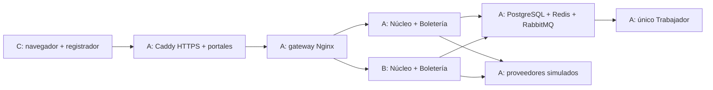

# Demostración ZeroTier: dos servidores A/B y un cliente C

Estado **16/11/2026: reparto real confirmado; esperando diagnósticos A/B**.
Este checkout es **C: Mac de Sebastián, solo navegador y registrador**. Aquí no
se construyen/arrancan servidores o bases ni se presupone SSH a los demás equipos.
Trabajo únicamente en `feature/sebastian`. La referencia anterior `35127bf`
quedó integrada por PR #53 en `develop`, merge `c4c5793`; la rama se actualizó
mediante `fetch` y `merge --ff-only`, conservando el trabajo local, sin reset ni
force-push. PR #54 sigue abierto hacia `develop`, base revisada `ed4e9c7` al
inicio de esta etapa, sin merge o auto-merge; conserva su evidencia CI anterior.

El requisito sustituye «un servidor con varios clientes»: **dos computadores de
aplicación y un cliente**. El caso futuro apaga manualmente **toda la VM B mientras
atiende solicitudes reales de C**, sin apagar el hipervisor universitario. A
permanece encendido. No se instala ZeroTier,
unen nodos, crean redes, cambian firewalls ni ejecutan caídas reales en esta
entrega. **El apagado queda para otra etapa**, después del reparto real y de
confirmar quién puede volver a encender la VM desde la plataforma universitaria.
Se conserva ARPUJ para administrarla; no cambiar rutas para el montaje.
No se operan Redash u otros proyectos. No acredita disponibilidad mensual
ni completa RNF-03/04/05/06/10.

## Montaje implementado

| Equipo | Componentes del ámbito exclusivo | Durante el apagado de B |
|---|---|---|
| A, Mac de Samuel | Caddy/HTTPS, gateway, portales, PostgreSQL, Redis, RabbitMQ/vhost, pasarela/correo simulados, un Trabajador y una instancia Núcleo/Boletería | Mantiene entrada, datos, sesión y aplicaciones; debe soportar toda la carga |
| B, VM Javeriana Ubuntu22.04.5 | **Únicamente Núcleo y Boletería**, mismos SQL/Redis/AMQP/claves/proveedores de A | Apagado completo de la VM solo en etapa futura con responsable de reencendido confirmado; no ejecuta preparación, semillas, Trabajador ni reconstrucciones administrativas |
| C, Mac de Sebastián | Navegador y registrador Python; nombre HTTPS estable de A | Conserva URL, sesión y solicitudes durante la caída; registra errores sin reintentos |



| Fallo | Qué se puede demostrar | Límite explícito |
|---|---|---|
| Proceso de B terminado | Atención posterior por A; posible reinicio según Docker | No equivale a apagar el computador; una solicitud en curso puede interrumpirse |
| Contenedor de B detenido | A atiende mientras ese contenedor está detenido | `stop` no demuestra reinicio automático ni fallo del host |
| **VM B apagada, caso futuro acordado** | C continúa hacia A con la misma URL/token; se miden interrupción y recuperación | Requiere tráfico reciente de B acreditado antes; HTTP/SSE ligados a B pueden caer |
| A apagado | Se pierden entrada y dependencias comunes | **No hay tolerancia a esta caída** |
| Caddy/gateway/PostgreSQL/Redis/RabbitMQ/Trabajador de A | Efecto según dependencia | Siguen siendo puntos únicos de fallo; no hay réplica de datos ni conmutación del ingreso |

## Herramientas y comandos reproducibles

**Primero [ETAPAS-REALES.md](../../App/infra/zerotier/ETAPAS-REALES.md)**: comandos
cortos de diagnóstico A/B, preservación de sus ramas/cambios y procedimiento de
CA de ensayo en A/confianza en C. No avanzar al arranque antes de los resultados.
Direcciones/ID de red reales y borradores están fuera de Git; este plan conserva
marcadores. Nombres HTTPS propuestos: `hexacore.zt.test` y `admin.hexacore.zt.test`.

El procedimiento íntegro de las etapas posteriores está en
[App/infra/zerotier/README.md](../../App/infra/zerotier/README.md).
Los ejemplos [equipo](../../App/infra/zerotier/equipo.example.json) y
[cliente](../../App/infra/zerotier/cliente.example.json) tienen marcadores
**inválidos hasta completar los datos reales**, sin secretos ni IP asignadas.
Python usa biblioteca estándar. No se añade una plataforma.

1. A/B ejecutan los diagnósticos de solo lectura del documento por etapas.
   Revisar capacidad/puertos y coordinar el mismo SHA limpio. C no necesita Docker.
   Si un checkout tiene cambios/otra rama, preservarlo y usar una copia nueva de
   `feature/sebastian`; no stash/reset/clean/switch forzados.
2. A genera secretos en un directorio privado **nuevo** con `crear-secretos`;
   A/B acuerdan su transferencia segura. Solo A conserva la privada TLS.
3. A/B completan sus JSON con `<IP_ZT_A>`, `<IP_ZT_B>`, `<ID_RED_PRIVADA>`,
   `<NOMBRE_WEB_ZT>`, `<NOMBRE_ADMIN_ZT>`, puertos y rutas propias. B usa `tls:null`.
   Ejecutan `configurar`, `validar` y `construir --directorio <MONTAJE_ROL>`.
4. **Solo A**, una vez: `preparar --directorio <MONTAJE_A> --cuentas-demo` sobre
   ámbito vacío, si se eligen las cuentas de prueba existentes; después `iniciar`.
   Sin esa opción no se siembran cuentas. Crear un evento publicado/vigente con
   los flujos actuales y congelar escrituras durante la medición.
5. B: `iniciar`, `comprobar`, `estado --salida <ESTADO_B_NUEVO>`; A: `comprobar`,
   `estado --salida <ESTADO_A_NUEVO>`. Cada comando requiere `--directorio` del rol.
6. C completa su JSON con SHA común, `<IP_ZT_C>`, CA confiable y `upstreams_a`
   **copiados del estado real** de A; ejecuta `cliente.py comprobar`, `sesion` e
   `iniciar --duracion 180`. Véanse argumentos y terminales del paso5 del README.
7. A entrega logs correlacionados a C por canal autorizado/export reciente; no se
   presupone SSH. C mantiene `importar-logs` y el registrador funcionando, y consulta
   `cliente.py reparto` con ambos estados: valida tráfico real sin armar ni crear
   marcas. Esta etapa termina ahí; no se apaga B.
8. **ETAPA POSTERIOR BLOQUEADA** hasta confirmar recuperación desde plataforma.
   Solo entonces C ejecutaría `armar` y `marcar --evento apagar-b` con ambos estados,
   y el operador apagaría manualmente la VM B. C sigue midiendo, marca `b-apagado` tras
   confirmación de VM apagada en plataforma, consulta `informe` y verifica sesión en navegador.
9. Al finalizar, cada A/B usa `equipo.py parar --directorio <MONTAJE_ROL>`: solo
   servicios con propietario/checkout/rol comprobados, sin eliminar datos o volúmenes.

No ejecutar literalmente marcadores. Los comandos completos del README usan
`ZT_PRIVADO` fuera de Git. La herramienta rechaza archivos previos, red no
privada/no autorizada, IP no asignada al rol, Docker remoto, puertos ocupados,
recursos ajenos, configuración alterada o fuente sucia/diferente. Los errores de
Compose quedan en archivos privados, no se reintentan a ciegas.

### Rutas de red y HTTPS

| Trayecto | Publicación predeterminada | Comprobación |
|---|---|---|
| C → A | HTTPS443, en `<IP_ZT_A>`; dos nombres de portal | DNS resuelve solo A, CA/cadena/SAN/clave/vigencia y navegador sin excepciones TLS |
| Gateway A → B | Núcleo3002 y Boletería3001, en `<IP_ZT_B>` | `/api/v1/salud` desde **el contenedor gateway** y solicitudes reales del observador |
| Aplicaciones B → A | PostgreSQL5432, Redis6380, AMQP5672, correo3098, pasarela3099 | SELECT de preparación/historiales, PING Redis, conexión autenticada al vhost y HTTP salud desde **el contenedor Núcleo B** |
| Dentro de A | gateway8080, portales4200/4201, Trabajador3006 y aplicaciones | No publicados hacia C; Caddy enruta API/portal en el mismo origen |

Todos son parametrizables. No se publica RabbitMQ15672 ni HTTP80. Proveedores
solo en la IP ZeroTier de A; acordar/verificar reglas efectivas que restrinjan
esos cinco puertos a A/B, sin abrirlos en Internet ni desactivar firewalls.
**Redis actual carece de contraseña en sus clientes**: una red con miembros no
controlados no satisface este aislamiento. Las herramientas no cambian reglas.
Si Docker Desktop/VM no enruta hacia ZeroTier o no puede enlazar la IP del host,
la ejecución queda bloqueada; el ping de los anfitriones no es prueba suficiente.

Caddy reutiliza portales/configuración relativa y recibe certificados provistos,
sin ACME automático ni autoridad nueva. C y navegador deben confiar legítimamente
en la CA; no se admite `-k`, hostname desactivado o `CERT_NONE`. Móvil es opcional
por confirmar: exige ruta/confianza propias y `HEXACORE_API=https://<NOMBRE_WEB_ZT>`
sin `/api/v1`. La medición principal acordada es navegador/registrador en C.

### Gateway, sesiones, datos y convivencia

El generador deriva el Compose base y conserva Dockerfiles, njs, autorización,
permisos y parámetros SSE. Elimina nombres fijos/puertos/dependencias anteriores,
selecciona solo los servicios del rol y crea nombres/red/volúmenes/etiquetas
`hxc-zt-<demo>-a/b`. No hereda credenciales/.env/proveedores reales. Base, Compose
remoto y escalado permanecen intactos: remoto arranca más piezas de las requeridas
por B, escalado solo descubre réplicas dentro de un Docker y producción cierra
los proveedores que B necesita. No aplicar esos overrides a ciegas al montaje.

El gateway de A conserva DNS Docker local y añade IP/puerto explícitos de B a
ambos upstreams. `X-Servidor` identifica el destino; `X-Demo-Solicitud` y log JSON
correlacionan ID/ruta/HTTP/upstream/tiempo sin tokens, cookies o query. La política
propia fija **`proxy_next_upstream off`, un intento**, `max_fails=1` y
`fail_timeout=10s`; conserva conexión5s/HTTP35s/SSE1h sin buffering. No agrega
`non_idempotent` ni reintentos de escrituras financieras. Detección pasiva y
DNS5s no garantizan una cota de recuperación. Se conserva Cola25 del Compose,
frente al default100 del código; el secreto de webhook solo se entrega a Núcleo.
La llamada njs de Cola sigue usando
Boletería **local de A**: compras fuera de la carga de caída.

A prepara SQL con el CLI vigente/advisory lock, **11 esquemas de negocio y 36
migraciones** en el código revisado, frente a 18 fuentes originales. La tabla
operativa `migracion_control.demo_zerotier` registra demo/SHA/EN_CURSO/LISTA; B exige
LISTA y misma fuente, sin ejecutar migraciones ni semillas. La opción de primeras
cuentas reutiliza únicamente Identidad después de comprobar tablas de negocio
vacías; su CLI contiene TRUNCATE, por lo que se bloquea sobre datos presentes.
Solo ese hijo de fixtures usa development, requerido por el CLI existente; las
apps siguen production. Una preparación parcial queda bloqueada y se conserva
para diagnóstico, sin resiembra automática. Salida con contraseñas de fixtures
exclusivamente en archivo privado600; nunca Git/Brightspace.

Ambos Núcleos comparten privada JWT/emisor/SQL/Redis, y Boleterías/gateway la
pública. Se conservan validación directa del backend, revocación/permisos y
rechazo restrictivo si Redis no es comprobable. HTTPS del mismo origen y
`NODE_ENV=production` mantienen cookie HttpOnly/Secure/SameSiteStrict, sin afinidad
ni cambio de URL. No se alteran [token-sesion](../../App/shared/seguridad/token-sesion.md)
o [permisos](../../App/shared/seguridad/permisos.md). Un SSE ligado a B se corta;
la reconexión existente no es migración del flujo ni reintento financiero.

Las aplicaciones conservan sus consumidores/tareas de arranque: no se afirma
que B sea solo HTTP. Ventas/Postventa tienen leases Redis50/60s; outboxes y
Evacuación usan SQL/locks/SKIP LOCKED, con reentrega posible; Logística conserva
deduplicación en memoria; Alimentos sondea5s y recupera ajustes al iniciar con
guardas SQL/Lua. Revocaciones/permisos se reconstruyen según su bootstrap actual,
no mediante un trabajo administrativo adicional desde B. Un solo Trabajador
limita Correo. **No se certifica ejecución exactamente una vez ni la convivencia
completa ante fallos de dos computadores**. No usar pendientes financieros/stock
para el ensayo; F12 y nuevos casos de uso siguen fuera de alcance. Inventario de
tareas y límites por módulo en el README.

## Validación y evidencia exacta

La puerta de apagado exige registrador activo, misma fuente/red/roles, dos apps
healthy por equipo, diez respuestas recientes correctas por lectura, cartelera
no vacía y datos iguales; al menos tres respuestas de A y B por lectura con
**ID+HTTP+X-Servidor correlacionados en logs del gateway**. Las de B deben tener
≤10s y relojes UTC compatibles (≤2s con el log). El armado vence en5s y marcar
apagar-b vuelve a validar tráfico; ni salud ni inventario bastan. No envía kill.

El observador realiza GET públicos/autenticados cada0,5s por lector, sin retries,
redirects, cambio de origen, login o renovación automáticos. Guarda intentos,
HTTP, errores de transporte, duración y huellas de datos/identidad/sesión. Sigue
muestreando después de un fallo. El informe conserva solicitudes sin final/en
curso/interrumpidas y calcula latencias, intervalos entre éxitos, primera A y diez
A consecutivas posteriores a la confirmación. La marca humana, muestreo y timeout
limitan precisión; no inventar una duración de recuperación si falta evidencia.
Revisar además sesión y origen del navegador antes/después: el token del
registrador acredita su propia sesión, no una validación visual inexistente.

| Comprobación de esta entrega | Resultado / alcance |
|---|---|
| Referencias Git/PR | `ed4e9c7` y PR54 abierto verificados al inicio; feature/sebastian limpia, origin/develop en c4c5793. Actualización normal, sin reset/force |
| Reparto y red informados | A Mac Samuel, B VM Javeriana Ubuntu22.04.5, C Mac Sebastián. Red/tres IP recibidas y borradores privados. Pings C→A/B5/5 cada uno informados por usuario; Samuel informa comunicación A/B. No prueban contenedores |
| Lecturas de C en esta etapa | CLI: red correspondiente PRIVATE/OK e IP de C coincidente; rutas a A/B por interfaz ZeroTier. No se repiten pings ni opera Docker. Sin acceso/diagnóstico remoto supuesto |
| Medición histórica del Mac, hoy C | macOS27 arm64/Mac14,2, 8GiB físicos/8CPU; Docker29.7.2, Compose5.3.1, motor2912MiB en consulta inicial. Después CLI ZeroTier1.16.2: primero consulta2 y a las 18:26 UTC una red PRIVATE/OK con una IP; valores reales privados; asignación posterior confirmada C, no describe capacidad de A/B |
| Guarda de memoria | Último valor comprobado no cumple A≥6144MiB ni B≥3072MiB. En la consulta posterior Docker info sale1/socket ausente; no se inicia/restaura el motor ni se operan proyectos. A/B deben entregar su propia capacidad; no trasladar a Samuel la memoria de C |
| Evidencia anterior Python/Compose/HTTPS, reutilizada | 51/51 locales, incluidos errores de entradas, memoria, preparación con apps activas y TLS. Compose renderiza sin crear recursos; sin SQL/semillas/caídas reales |
| Evidencia anterior de preparación, reutilizada | 7/7; valida B prohibido, datos presentes, repetición y fallo parcial. No ejecuta semillas o SQL reales |
| Incidencias locales conservadas | Primer intento45: command:null de Compose5; se eliminan nulos y rechazan comandos administrativos. Segundo48: variable del bucle ocultaba secretos; corregida. Logs privados, sin ocultar fallos |
| Gateway/njs/Caddy reales | Prueba propia añadida a CI con dos dobles Node aislados: auth401/403, reparto, correlación, POST interrumpido sin reenvío, TLS, SSE y caída de un doble. [CI92](https://github.com/Emperador24/HEXACORE/actions/runs/43927587452), dabd181: **8/8 trabajos aprobados**, proxy con503 visible y atención posterior por A. Última referencia/CI en [PR54](https://github.com/Emperador24/HEXACORE/pull/54); **no prueba hosts/VPN** |
| Evidencia anterior reutilizada | Seguridad167/167 operaciones protegidas, regresiones y SSE con límites de RESULTADO/SECURITY-SAFETY; no se repiten matrices ni se declaran RNF05/06 completos |
| Consulta reparto sin armar | Dos pruebas nuevas de CLI y una de la guarda de armado: 3/3 locales, sin Docker/SQL/certificados nuevos; comprueba éxito/rechazo y registro inmutable |
| CA/TLS de ensayo | Plantillas y procedimiento de generación en A/confianza en C preparados y sintaxis revisada; **CA no generada, confianza no instalada, HTTPS real pendiente** |
| Sistema A/B/C funcionando | **PENDIENTE**. Equipos/red/IP recibidos; faltan diagnósticos, SHA común limpio, disco, puertos, CA/TLS, datos y sondas desde contenedores |
| Prueba real de caída | **PENDIENTE, no ejecutada**. Primero acreditar B con tráfico de C. Requiere responsable/permiso de reencendido en plataforma; ARPUJ por sí sola no acredita esa capacidad |

Comandos locales de herramientas (sin arrancar Docker):

```bash
python3 -m unittest discover -s App/infra/zerotier -p 'test_*.py' -v
node --test App/infra/zerotier/preparacion-demo.test.cjs
node --check App/infra/zerotier/sonda.cjs
```

La prueba de proxy tiene guarda GitHub Actions y solo limpia IDs/etiquetas propios
del runner. No usar el `demo-disponibilidad.sh` histórico aquí: escala y mata un
proceso automáticamente. Logs, credenciales, certificados, estados reales y
registros C se conservan fuera de Git. Las cifras históricas de 8 esquemas/18
migraciones, pruebas de200 usuarios o caída breve no acreditan 11/36 actuales,
2000 usuarios ni disponibilidad mensual.

## Datos exactos pendientes y trabajo por participante

- **En conjunto:** reparto A/B/C confirmado; faltan operador y reencendido B,
  OS/arquitectura/CPU/RAM disponible de los servidores,
  almacenamiento libre **del motor Docker/VM** además del checkout, versiones y
  ventana autorizada. A requiere capacidad para los proveedores y toda la carga;
  B debe poder apagarse sin afectar proyectos ajenos.
- **Dueño de red y cada participante:** red privada y tres IP recibidas, fuera
  de Git; verificar asignación/rutas con ARPUJ activo, permisos CLI y reglas de
  acceso efectivas, relojes sincronizados y conectividad de las VM/contenedores.
- **A:** dos nombres DNS hacia A, puertos sin colisión, certificado/clave/cadena
  SAN y CA legítima para C, directorio nuevo, SHA limpio y secretos propios;
  ejecutar preparación única, aplicaciones/datos de ensayo y export de estado/logs.
- **B:** mismo SHA/secretos, puertos de sus dos apps, rutas verificadas a los cinco
  proveedores, estado exportado; responsable presente para apagado/restauración manual.
- **C:** IP propia, resolución de los dos nombres, confianza TLS del navegador y
  Python, estado A/B/mapa real de upstreams, cuenta propia/fixture exclusiva y
  evento publicado; canal autorizado para logs, medición/confirmación en plataforma y
  revisión de sesión. Confirmar si se añade móvil; no es precondición web.

Con esos datos quedan disponibles configuración, construcción, preparación única,
sondas desde contenedores, HTTPS, registro/gate e informe reproducibles. Faltan la
ejecución en A/B reales desde C y su evidencia; no se sustituyen por CI o salud.

Referencias oficiales consultadas 16/11/2026:
[ZeroTier CLI](https://docs.zerotier.com/cli/),
[alta/autorización privada](https://docs.zerotier.com/start/),
[ZeroTier con Docker](https://docs.zerotier.com/docker/),
[Nginx reenvío](https://nginx.org/en/docs/http/ngx_http_proxy_module.html#proxy_next_upstream),
[Caddy TLS](https://caddyserver.com/docs/caddyfile/directives/tls).
La VPN no instala confianza HTTPS ni une DNS bridge de distintos Docker.
